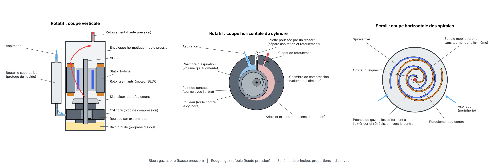

# Compresseur : synthèse et cahier des charges

Objectif du projet : PAC de fenêtre réversible R290, 1500 €, COP 5 à 6, petite
taille. Cette note mesure ce que le compresseur coûte au COP, fixe les
rendements à exiger et propose une cylindrée. Les tableaux détaillés sont
dans [`resultats_compresseur.md`](resultats_compresseur.md), régénérés par :

```bash
python outils/etude_compresseur.py -o docs/resultats_compresseur.md
```

Comparaisons à **puissance fixée** (la régulation cherche la fréquence).
Compresseur **générique** du simulateur : les chiffres absolus seront à
refaire avec une carte constructeur, les tendances et ordres de grandeur sont
ce qui compte ici.

## 0. Principe : rotatif et scroll



Figure générée par `python outils/figure_compresseurs.py docs/schema_compresseurs.png`
(schéma de principe, proportions indicatives).

* **Rotatif** : un rouleau monté sur un excentrique de l'arbre roule contre
  le cylindre. La palette, poussée par un ressort, sépare la chambre
  d'aspiration (qui grandit) de la chambre de compression (qui rétrécit). Un
  clapet s'ouvre quand la pression de refoulement est atteinte, ce qui adapte
  le compresseur à tout taux de compression. L'enveloppe est à haute
  pression : le gaz refoulé traverse et refroidit le moteur.
* **Scroll** : la spirale mobile orbite (sans tourner sur elle-même) contre
  la spirale fixe. Les poches de gaz se forment à la périphérie et
  rétrécissent jusqu'au centre. Le taux de compression est fixé par la
  géométrie.

## 0 bis. Ce qui réduit l'efficacité d'un compresseur rotatif

| Perte | Origine | Quand elle est forte | Dans le simulateur |
|---|---|---|---|
| Fuites internes | jeux palette / fente, rouleau / cylindre, faces axiales : le gaz comprimé retourne vers l'aspiration | **basse vitesse** (le gaz a plus de temps pour fuir) et **taux de compression élevé** | `k_fuite` (η_v), forme de η_is(f) |
| Échauffement à l'aspiration | le gaz aspiré se réchauffe au contact du bloc et de l'enveloppe chaude (haute pression) : densité plus faible, travail plus grand | taux de compression élevé, refoulement chaud | implicite dans η_is, η_v |
| Pertes de charge | orifices et clapets d'aspiration et de refoulement, silencieux | **haute vitesse** (débit élevé) | forme de η_is(f), `dT_aspiration`, `dT_refoulement` |
| Espace mort | le gaz resté dans l'orifice de refoulement se re-détend dans la chambre | taux de compression élevé | `espace_mort` (η_v) |
| Frottements mécaniques | palette sur rouleau, paliers, cisaillement de l'huile | haute vitesse, huile froide ou trop visqueuse | inclus dans η_is |
| Pertes moteur | cuivre (courant, donc couple : fort taux de compression), fer (haute vitesse), aimants qui s'échauffent | aux deux extrêmes de vitesse | `eta_mot_max`, `f_mot_opt` |
| Pertes variateur | conduction et commutation des transistors | faible charge (rendement relatif plus bas) | `eta_variateur` |
| Pertes thermiques | chaleur cédée par l'enveloppe à l'air ambiant | compresseur chaud, mal isolé | `pertes_carter` |
| Point de fonctionnement | taux de compression ou vitesse loin de ceux pour lesquels le compresseur a été optimisé | compresseur de climatiseur (PR 3 à 3,5) utilisé à PR 2,5 | `PR_opt`, `f_opt` |

Conséquences pour le projet :

1. **Réduire le taux de compression** est le levier le plus fort : grands
   échangeurs (petits pincements), pertes de charge faibles, surchauffe
   réduite. Toutes les pertes ci-dessus diminuent avec lui.
2. **Choisir un compresseur optimisé pour les faibles taux et les basses
   vitesses** (séries « basse charge » ou haut rendement), puisque c'est là
   que la machine passe le plus de temps.
3. **Bicylindre** : vibrations plus faibles à basse vitesse, ce qui permet de
   descendre plus bas en vitesse sans cycler.

## 1. Ce que le compresseur coûte aujourd'hui

| Point | f (tr/s) | PR | η global | COP perdu par le compresseur | COP unité |
|---|---|---|---|---|---|
| Chauffage 7/20, 1,6 kW | 28 | 2,4 | 0,62 | 35 % | 4,9 |
| Chauffage 7/20, 3,2 kW | 60 | 2,9 | 0,65 | 32 % | 4,2 |
| Clim 35/27, 2,6 kW sensible | 52 | 2,6 | 0,65 | 35 % | 3,7 |

η global = η_is · η_mot · η_var (puissance isentropique / puissance
électrique du compresseur). Le compresseur et son moteur font perdre environ
un tiers du COP du cycle. C'est le plus gros poste après les pincements des
échangeurs.

Points clés :

* **Taux de compression faibles** (2,2 à 3,1) aux points qui comptent pour
  l'objectif. Un rotatif de climatiseur est souvent optimisé pour PR 3 à 3,5
  (conditions ASHRAE / ARI). Il faut un compresseur dont le meilleur
  rendement tombe vers PR 2,5.
* **Basses vitesses** (20 à 30 tr/s) à charge partielle, là où le COP 5 à 6
  est atteignable : c'est là que le moteur et les fuites internes pénalisent
  le plus. Le rendement à 20 à 40 tr/s est le critère de choix, pas le
  rendement au point nominal du catalogue.

## 2. Rendement global à exiger

η global requis (cycle figé, approximation) :

| Point | Échangeurs | COP 5 | COP 5,5 | COP 6 |
|---|---|---|---|---|
| Chauffage 7/20, 1,6 kW | actuels | 0,63 | 0,70 | 0,77 |
| Chauffage 7/20, 3,2 kW | actuels | 0,80 | 0,89 | 0,99 |
| Clim 35/27, 2,6 kW sens. | actuels | 0,90 | 1,00 | 1,11 |
| Chauffage 7/20, 1,6 kW | améliorés | 0,53 | 0,59 | 0,65 |
| Chauffage 7/20, 3,2 kW | améliorés | 0,64 | 0,72 | 0,80 |
| Clim 35/27, 2,6 kW sens. | améliorés | 0,64 | 0,72 | 0,79 |

« améliorés » : UA x2 et débits d'air x1,5 (voir README, objectif).

Ordre de grandeur réaliste pour un petit rotatif BLDC R290 : η global 0,62 à
0,68 pour un bon modèle du commerce, 0,70 à 0,72 pour le meilleur de sa
catégorie (η_is ≈ 0,78, moteur IPM ≈ 0,95, variateur ≈ 0,98). Un η global
supérieur à 0,75 n'est pas réaliste pour un rotatif de cette taille.

Conclusions :

1. **Avec les échangeurs actuels, le compresseur ne suffit pas** : COP 5 à
   pleine charge demanderait η global 0,80 ou plus. Seule la charge partielle
   en chauffage atteint 5 (η 0,63 à 0,70).
2. **Avec les échangeurs améliorés**, un compresseur à η global ≈ 0,70 donne
   COP 5 à 5,5 à pleine charge (chauffage 7 °C et clim 35 °C) et environ 6 à
   charge partielle. **COP 6 à pleine charge reste hors de portée**
   (η 0,80 requis).
3. Gain de COP par point de rendement (sensibilité, chauffage 7/20 3,2 kW) :
   η_is 0,72 → 0,78 : +6 % ; η_mot 0,935 → 0,965 : +3 %.

## 3. Cylindrée

À débit d'air fixé, la cylindrée change peu le COP (± 2 % entre 10 et
24 cm³). Elle fixe surtout la **plage de modulation** :

| Cylindrée (cm³) | P mini à 7 °C, 15 tr/s (kW) | P maxi à -7 °C, 110 tr/s (kW) |
|---|---|---|
| 10 | 0,59 | 2,6 |
| 12 | 0,69 | 3,0 |
| 14 | 0,80 | 3,4 |
| 16 | 0,90 | 3,8 |
| 20 | 1,09 | 4,5 |

Pour une pièce de 50 m² bien isolée, la charge à 7 °C est souvent sous 1 kW.
En dessous de la puissance mini, le compresseur cycle (perte Cd = 0,15 dans
le modèle). **Recommandation : 12 à 14 cm³**, f_min 10 à 15 tr/s,
f_max 110 à 120 tr/s. C'est aussi un compresseur plus petit et plus léger,
cohérent avec la petite taille. 16 cm³ seulement si une puissance de 3,5 kW
à -7 °C est exigée.

Constat annexe : avec la loi actuelle du simulateur, les ventilateurs suivent
la fréquence du compresseur. Un compresseur plus petit tourne plus vite à
même puissance, donc ventile plus, et paraît meilleur à tort (jusqu'à +10 %
en clim à charge partielle). La loi de ventilation doit être optimisée
indépendamment du compresseur (étape suivante possible : chercher le débit
optimal à chaque point).

## 4. Candidats du marché (à vérifier sur fiches officielles)

Informations de distributeurs et places de marché, conditions d'essai souvent
non précisées : **non exploitables telles quelles** pour le simulateur.

| Modèle (marque annoncée) | Type | Cylindrée | Données annoncées | Prix annoncé |
|---|---|---|---|---|
| GMCC DTN180D32UFZ | rotatif bicylindre DC inverter R290 | 18,1 cm³ | 3,18 kW, 785 W, COP 4,05 | n.d. |
| GMCC DTN210D32UFZ | rotatif bicylindre DC inverter R290 | 21 cm³ | 3,68 kW, 897 W, COP 4,10 | 103 à 143 $ |
| GMCC EDTN210D32EFZ | rotatif DC inverter R290, PAC | 21 cm³ | 12 à 120 tr/s, refoulement max 115 °C | 108 à 148 $ |
| GMCC DSM180D19UDZ | rotatif DC inverter | 18 cm³ | 30 à 120 tr/s, hauteur 302 mm | n.d. |
| Highly PTL232SDN | rotatif DC inverter R290 | n.d. | 3,85 kW | n.d. |

Lecture :

* Les modèles trouvés font 18 à 21 cm³, au-dessus de la cylindrée
  recommandée. Les petites cylindrées R290 inverter (10 à 14 cm³) existent
  chez GMCC, Highly, Landa et Rechi mais aucune fiche n'a été trouvée : à
  demander directement.
* **Prix unitaire autour de 100 à 150 $**, soit moins de 10 % du budget de
  1500 €. Le prix n'est pas une contrainte : il faut prendre le meilleur
  rendement disponible.
* Le bicylindre réduit vibrations et bruit (important pour une fenêtre) au
  prix d'un peu de rendement à basse vitesse.

## 4 bis. Catalogue GMCC des rotatifs (édition 2024) : données R290 inverter

Source : catalogue « Rotary Compressor Product Catalog » de GMCC (pages
« Green refrigerant compressor » et « Refrigerating capacity test condition »).
La page produit du site gmcc-welling.com est construite en JavaScript depuis
un autre domaine et n'a pas pu être lue dans cette session.

**Conditions d'essai « SEER60 »** des compresseurs inverter du catalogue :

| Condensation | Liquide | Évaporation | Aspiration | Ambiance | Vitesse | Puissance |
|---|---|---|---|---|---|---|
| 42,3 °C | 34,3 °C | 2,7 °C | 12,8 °C | 35 °C | 60 tr/s | variateur inclus |

Ce point est très proche de notre point de chauffage 7 / 20 °C à pleine
charge (simulateur : Te 1,8 °C, Tc 40,1 °C, PR 2,9). Taux de compression du
point SEER60 avec R290 : 2,80.

**Rotatifs R290 inverter du catalogue** (220-240 V, 50 Hz, essais SEER60).
η_v et η global recalculés ici à partir de la puissance frigorifique et de
la puissance absorbée (propriétés CoolProp) :

| Modèle | Type | Cylindrée (cm³) | Froid (W) | Absorbé (W) | COP | η_v | η global |
|---|---|---|---|---|---|---|---|
| DSM165D19UDZ | monocylindre | 16,5 | 2885 | 725 | 3,98 | 0,90 | 0,665 |
| DSM180D19UDZ | monocylindre | 17,9 | 3150 | 788 | 4,00 | 0,91 | 0,668 |
| DSN180D54UEZ3 (en développement) | monocylindre | 18,0 | 3120 | 735 | 4,24 | 0,89 | 0,709 |
| DSN210D54UEZ3 (en développement) | monocylindre | 21,0 | 3705 | 872 | 4,25 | 0,91 | 0,710 |
| DTN180D32UFZ | bicylindre | 18,1 | 3180 | 785 | 4,05 | 0,90 | 0,677 |
| DTN210D32UFZ | bicylindre | 20,9 | 3680 | 897 | 4,10 | 0,91 | 0,686 |
| DTN210D54UEZ3 | bicylindre | 20,9 | 3675 | 882 | 4,17 | 0,90 | 0,696 |
| DTN250D32UFZ | bicylindre | 25,0 | 4380 | 1085 | 4,04 | 0,90 | 0,675 |

η global = débit × (h2s - h1) / puissance absorbée, variateur compris.

Lecture :

* **Le modèle générique du simulateur est validé en ordre de grandeur** :
  aux mêmes conditions, il donne η_v 0,91 et η global 0,65 (contre 0,67 à
  0,71 pour GMCC). Il est légèrement pessimiste, de 2 à 9 %.
* **Le meilleur R290 du catalogue atteint η global 0,71** (nouvelle série
  « N...D54 », en développement). C'est la valeur retenue comme « meilleur
  de sa catégorie » plus haut, et elle suffit, avec les échangeurs
  améliorés, pour un COP d'environ 5,5 à pleine charge.
* **Pas de R290 inverter sous 16,5 cm³** dans ce catalogue. Le 13,3 cm³
  R290 (DSM135V11VDZ, COP 4,39 en conditions GX) est à vitesse fixe. Les
  cylindrées recommandées (12 à 14 cm³) sont donc à demander à GMCC ;
  sinon, 16,5 à 18 cm³ avec une vitesse minimale aussi basse que possible
  (12 tr/s est annoncé pour l'EDTN210D32EFZ).
* Les données SEER60 ne sont qu'**un seul point à 60 tr/s**. Le rendement à
  20 à 30 tr/s, qui compte le plus pour l'objectif, reste à obtenir (carte
  EN 12900 à plusieurs vitesses).
* Hauteurs indiquées dans le catalogue : 290 mm pour les DSM, 250 mm pour les
  DSN, 280 mm pour les DTN.

**Candidats à demander en priorité** :

1. **DSN180D54UEZ3** : meilleur rendement (0,71), cylindrée la plus proche
   du besoin, plus bas (250 mm). En développement en 2024, disponibilité à
   vérifier.
2. **DTN180D32UFZ** : bicylindre, donc moins de vibrations à basse vitesse
   (important pour une fenêtre), η 0,68, disponible.
3. **DSM165D19UDZ** : plus petite cylindrée R290 inverter du catalogue,
   η 0,665.

## 5. Cahier des charges à envoyer aux fabricants

| Critère | Exigence |
|---|---|
| Fluide | R290, huile compatible (POE ou PAG), charge d'huile minimale (solubilité du propane, limite IEC 60335-2-40) |
| Type | rotatif hermétique BLDC (IPM), mono ou bicylindre |
| Cylindrée | 12 à 14 cm³ (16 cm³ maximum) |
| Vitesse | 10 à 15 tr/s minimum, 110 à 120 tr/s maximum |
| Rendement | η global ≥ 0,68 à PR 2,5 et 30 tr/s, ≥ 0,70 à PR 2,5 et 60 tr/s |
| Enveloppe | Te -25 à +15 °C, Tc 25 à 60 °C, refoulement ≥ 115 °C |
| Encombrement | hauteur ≤ 260 mm, masse ≤ 8 kg (à confirmer avec le dessin du boîtier) |
| Données à fournir | carte EN 12900 (polynômes 10 coefficients, débit massique et puissance électrique) à au moins 3 vitesses dont 20 à 30 tr/s ; conditions de référence ; rendement du variateur recommandé |
| Variateur | référence du variateur et de l'algorithme de commande (sans capteur, FOC) compatibles |

La carte reçue se branche directement :
`python simulateur.py --carte cartes/xxx.json` (voir README).

## 6. Étapes suivantes

Bibliographie sur les pertes en fonction de la vitesse :
[`bibliographie_compresseur.md`](bibliographie_compresseur.md).

1. Demander les cartes EN 12900 de 2 ou 3 compresseurs 12 à 16 cm³ (GMCC,
   Highly, Landa).
2. Les charger et refaire cette étude avec des données réelles.
3. Découpler la ventilation de la fréquence du compresseur et chercher le
   débit d'air optimal à chaque point.
4. Évaluer les options qui réduisent le travail de compression : surchauffe
   réduite (2 à 3 K avec EEV précis), pertes de charge de la vanne 4 voies,
   échangeur interne liquide / aspiration (peu utile avec R290, à vérifier).

## Sources

* GMCC, Rotary Compressor Product Catalog (2024), via [hvacrcompressor.com](https://www.hvacrcompressor.com/downloadpdf/GMCC-rotary-compressor-catalogue.pdf)

* [Area Cooling, GMCC EDTN210D32EFZ](https://areacooling.com/p/edtn210d32efz/)
* [Area Cooling, GMCC DSM180D19UDZ](https://areacooling.com/p/dsm180d19udz/)
* [Qishanr, GMCC DTN180D32UFZ](https://www.qishanrcompressor.com/products/r290-gmcc-rotary-compressor-dtn180d32ufz.html)
* [Qishanr (made-in-china), GMCC EDTN210D32EFZ](https://qishanr.en.made-in-china.com/product/uaDUlXGWaxcO/China-R290-Gmcc-Hermetic-DC-Inverter-Rotary-Compressor-Edtn210d32efz-for-Heat-Pump.html)
* [Qishanr (made-in-china), GMCC DTN210D32UFZ](https://qishanr.en.made-in-china.com/product/UJjrOEzGJtcZ/China-R290-China-Gmcc-DC-Inverter-Twin-Rotary-Air-Conditioner-Compressor-Dtn210d32ufz.html)
* [Qishanr, Highly PTL232SDN](https://qishanr.com/products/r290-highly-inverter-compressor-ptl232sdn)
* [OSTI, rendements mesurés d'un rotatif à vitesse variable et de son variateur](https://www.osti.gov/biblio/10175225)
