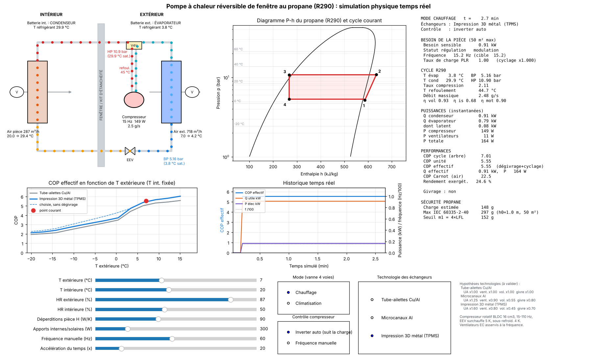

# Simulateur physique de la PAC (`pac_fenetre/`)

Étude de faisabilité "sur papier" d'une pompe à chaleur air/air réversible qui
s'installe dans une fenêtre d'appartement (battant en France / UE, guillotine aux
USA), pour une pièce de 50 m² maximum, avec du propane comme réfrigérant.

Cette première étape fournit un **simulateur physique temps réel** : on fait
varier les charges (températures et humidités intérieure / extérieure,
déperditions, apports) et on voit immédiatement l'effet sur le cycle et le COP.



Les commandes ci-dessous se lancent depuis la racine du dépôt. Retour au [document principal](../README.md).

## Lancer

```bash
python3.12 -m venv .venv && source .venv/bin/activate
pip install -r requirements.txt
python simulateur.py
```

L'interface s'ouvre dans le navigateur (http://127.0.0.1:8765/) : le calcul
physique tourne en Python (`pac_fenetre/moteur.py`, servi par
`pac_fenetre/serveur.py`), la page `pac_fenetre/web/index.html` ne fait que
l'affichage. Chaque réglage a un curseur et un champ de saisie (valider par Entrée).

Options : `--port 9000`, `--sans-navigateur`, `--tk` (ancienne interface
matplotlib, plus lente), `--capture vue.png [--mode clim]` (image sans fenêtre).
Tests de cohérence : `python tests/test_physique.py`.

## Ce que montre l'interface

| Zone | Contenu |
|---|---|
| Schéma animé | Circuit réel (compresseur, vanne 4 voies, EEV, deux batteries, traversée de fenêtre). Les points circulent à une vitesse proportionnelle au débit massique ; couleur = état du fluide. |
| Diagramme P-h | Cloche de saturation du propane (CoolProp, EOS de référence) et cycle courant 1-2-3-4. |
| COP = f(T ext) | Courbe recalculée à chaque changement, technologie choisie vs tube-ailettes classique, avec et sans dégivrage. |
| Historique | COP effectif, puissance utile, puissance électrique, fréquence inverter dans le temps simulé. |
| Panneau | Pressions, températures, débit, rendements, puissances, COP cycle / unité / effectif, Carnot, exergie, givrage ou déshumidification, charge de propane vs limite IEC 60335-2-40. |

Commandes : T ext, T int, HR ext, HR int, déperditions H (W/K), apports (W),
fréquence manuelle, accélération du temps ; mode chauffage / clim (avec
temporisation d'inversion de la vanne 4 voies) ; inverter auto ou manuel ;
technologie d'échangeur.

## Modèle physique (`pac_fenetre/physique.py`)

* **Fluide** : propane R290, propriétés réelles CoolProp (HEOS).
* **Compresseur** rotatif BLDC 16 cm³, 15 à 110 Hz : rendement volumétrique
  (espace mort + fuites dépendant de la vitesse), rendement isentropique fonction
  du taux de compression et de la fréquence, rendement moteur + variateur,
  pertes carter.
* **Échangeurs** : epsilon-NTU côté air, UA dépendant du débit (exposant 0,6).
  Évaporateur à batterie humide (modèle enthalpique, Lewis = 1) : capacité
  latente en été, formation de givre en hiver.
* **Détendeur électronique** : surchauffe 5 K, sous-refroidissement 4 K ; pertes
  de charge ligne d'aspiration et vanne 4 voies en équivalent température.
* **Résolution** : T évaporation et T condensation telles que puissance côté
  fluide = puissance côté air sur chaque batterie (Brent imbriqué, ~3 ms).
* **Régulation "intelligente"** : l'inverter cherche la fréquence qui égalise la
  capacité sensible au besoin de la pièce ; ventilateurs EC asservis ; en dessous
  de la fréquence mini, cyclage avec coefficient de dégradation Cd = 0,15 ;
  rampe de fréquence 1,5 Hz/s.
* **Dégivrage** par inversion de cycle : bilan sur un cycle givrage + dégivrage
  (masse de givre admissible, énergie de fonte prélevée dans la pièce).
* **Besoin de la pièce** : H × ΔT ± apports, plus pont thermique du kit fenêtre.
* **Sécurité** : charge estimée par les volumes internes et comparée à
  m_max = 2,5 × LFL^1,25 × h0 × √A (≈ 297 g pour 50 m², h0 = 1 m) et au seuil
  m1 = 4 × LFL ≈ 152 g. À revérifier selon l'édition applicable de la norme.

### Technologies d'échangeurs (hypothèses à valider)

| Technologie | UA | Puissance ventilateur | Volume interne | Capacité de givre |
|---|---|---|---|---|
| Tube-ailettes Cu/Al (référence) | x1,00 | x1,00 | x1,00 | x1,00 |
| Microcanaux aluminium | x1,25 | x0,90 | x0,55 | x0,80 |
| Impression 3D métal (TPMS, gyroïde) | x1,60 | x0,80 | x0,45 | x0,70 |

Ces multiplicateurs sont des **hypothèses de départ**, pas des résultats : ils
devront être remplacés par des corrélations (CFD ou essais) propres à la
géométrie imprimée. Le simulateur sert justement à voir quel gain de UA est
nécessaire pour atteindre un objectif de COP.

## Ordres de grandeur obtenus (TPMS, valeurs par défaut)

| Point | Fréquence | Capacité | COP / EER unité |
|---|---|---|---|
| Chauffage 7 / 20 °C | 60 Hz | 3,2 kW | 4,1 |
| Chauffage -7 / 20 °C | 90 Hz | 3,2 kW | 3,0 (2,7 avec dégivrage) |
| Clim 35 / 27 °C | 60 Hz | 3,1 kW | 3,6 |

## Limites actuelles et pistes

* Régime quasi-statique (pas de dynamique thermique des batteries ni de la pièce).
* Échangeurs sans découpage en zones (surchauffe / diphasique / sous-refroidi).
* Coefficients du compresseur génériques par défaut : brancher une carte
  constructeur (voir ci-dessous) dès qu'un compresseur R290 est sélectionné.
* Pas encore : recirculation d'air chaud au droit de la fenêtre, bruit,
  limitation de Te en clim pour garantir la déshumidification.

## Carte compresseur constructeur (`pac_fenetre/carte_compresseur.py`)

Le compresseur générique peut être remplacé par une carte constructeur
(polynômes 10 coefficients EN 12900 / AHRI 540 en fonction des températures de
rosée à l'aspiration S et au refoulement D, un jeu par vitesse, interpolation
linéaire entre vitesses).

```bash
python simulateur.py --carte compresseurs/xxx.json
```

```python
from pac_fenetre.physique import Conception, PompeAChaleur
pac = PompeAChaleur(Conception().avec_carte("compresseurs/xxx.json"))
```

* **Remplir une carte** : copier `compresseurs/MODELE_carte.json` (champ `_aide`
  détaillé). Si la fiche donne un tableau de points plutôt que des
  coefficients : `python compresseurs/ajuster_carte.py points.csv --surchauffe 10 -o compresseurs/xxx.json`.
* **Vitesses en tr/s mécaniques** : moteur 4 pôles, 60 tr/s = 120 Hz électriques.
* **Corrections aux conditions réelles** : débit × ρ_asp,réel / ρ_asp,carte ;
  puissance × (ṁ / ṁ_carte) × (Δh_is,réel / Δh_is,carte).
* **Bilan énergie** : la puissance électrique (moins les pertes carter) est
  cédée au gaz, le moteur d'un rotatif hermétique étant refroidi par le
  réfrigérant. η_mot vaut donc 1 dans ce mode et η_is, η_v affichés sont des
  rendements globaux déduits de la carte.
* **Plage de vitesse** reprise de la carte ; la vitesse nominale garde la même
  fraction x = f_nom / f_max.
* **Alarmes** : point (Te, Tc) hors enveloppe constructeur, vitesse hors carte.
* `compresseurs/SYNTHETIQUE_generique.json` est une carte **synthétique** ajustée sur
  le modèle générique, uniquement pour les tests (`python tests/test_carte.py`).
  Ce n'est pas un compresseur réel.

## Aéraulique physique (`pac_fenetre/aeraulique.py`)

Remplace la loi ventilateur P = P_nom × k_vent × r³ (toujours utilisée par
défaut) par un calcul physique :

```bash
python simulateur.py --aero config_air/xxx.json
```

1. **Courbe du circuit** : Δp(Q) de l'échangeur selon Kays & London
   (contraction d'entrée Kc, accélération due à l'échauffement de l'air,
   frottement f(Re) × 4L/Dh, expansion de sortie Ke), plus les accessoires
   (grilles, filtre) en K × ρu²/2.
2. **Point de fonctionnement** du ventilateur réel : vitesse donnée par les
   lois de similitude appliquées à la courbe constructeur.
3. **Puissance électrique** interpolée entre les courbes mesurées à plusieurs
   vitesses : la baisse de rendement des moteurs EC à basse vitesse est prise
   en compte (absente des lois de similitude seules).

* Un point hors des courbes constructeur (pression insuffisante, décrochage)
  donne une alarme et un COP indéfini, au lieu d'un chiffre trompeur.
* Corrélations de frottement : `canal_droit_PROVISOIRE` (canal droit
  circulaire, **pas un gyroïde**, pour tester) et `leeds_gyroide` (Qureshi,
  Leeds 2026, voir ci-dessous).
* `ventilateurs/W1G200-EC87-20.json` : courbes réelles de la fiche ebm-papst.
* `config_air/EXEMPLE_aeraulique.json` : géométrie, Kc, Ke et accessoires
  **fictifs**. Avec ce ventilateur réel, le point est hors courbes : il ne
  fournit pas assez de pression pour ce circuit.
* Avec un échangeur de type `gyroide`, l'UA et le volume interne de propane
  sont tirés de la même géométrie (voir ci-dessous). Avec un échangeur simple,
  l'UA suit toujours la loi UA ∝ débit^0,6 × multiplicateur de technologie.
* Tests : `python tests/test_aeraulique.py`.

## Échangeur gyroïde (`pac_fenetre/gyroide.py`)

Géométrie : F = sin X cos Y + sin Y cos Z + sin Z cos X (X = 2πx/L). Air pour
F > n_air, paroi entre n_propane et n_air, propane pour F < n_propane. Les
niveaux n sont sans dimension (le « R en mm » de la thèse est en réalité un
niveau sans dimension). Fractions de volume, surfaces, Dh et épaisseur de
paroi sont calculées numériquement ; elles reproduisent les tableaux 3.1 et
5.13 de la thèse à moins de 0,5 %.

Côté air (Qureshi, Leeds 2026, tableau 5.9) :

| | 20 ≤ Re < 130 | 200 ≤ Re ≤ 8000 |
|---|---|---|
| f (Fanning) | 25,21·Re^-0,743 + 0,1533 | 2,209·Re^-0,3243 + 0,3538 |
| j (Colburn) | 2,324·Re^-0,9467 + 0,03393 | 0,9448·Re^-0,4908 + 0,006636 |

Re sur Dh du réseau air et vitesse dans les pores ; interpolation linéaire
entre 130 et 200 (zone exclue des ajustements, alerte). h_air = j·G·cp·Pr^(-2/3).
UA = 1 / (1/(h_air·A_air) + e/(k·A_moy) + 1/(h_propane·A_propane)).

**Limites de ces corrélations** (analyse de la thèse) :
* établies pour de l'**eau** (Pr ≈ 7) : f est transposable à l'air, j est une
  estimation basse pour l'air en laminaire (jusqu'à ~2x) ;
* aucune validation externe au-delà de Re = 250 (RANS k-ω SST ensuite) ;
* parois lisses, paroi non modélisée, écoulement périodique sans effets d'entrée ;
* la dépendance à L rapportée en instationnaire (~9 %) contredit la similitude
  dynamique : elle est traitée comme une incertitude, f et j ne dépendent pas de L ;
* domaine : 5 ≤ L ≤ 40 mm, niveau air de 0 à 0,6 ; au-delà, alerte d'extrapolation ;
* l'épaisseur de paroi annoncée (« R = 0,3 → 1 mm ») est surestimée : le
  calcul donne ~0,63 mm pour L = 10 mm, et elle est proportionnelle à L.

Données d'entrée sans corrélation connue (hypothèses à fournir) : h côté propane,
conductivité de paroi, Kc, Ke. Ventilateur `rendement_constant` : hypothèse
P = débit × Δp / η pour explorer avant de choisir un vrai ventilateur.

```bash
python simulateur.py --aero config_air/EXEMPLE_gyroide.json
python conception_echangeur/outils/balayage_gyroide.py --debit 520 --UA 416 --dp-max 40
python tests/test_gyroide.py
```
